

  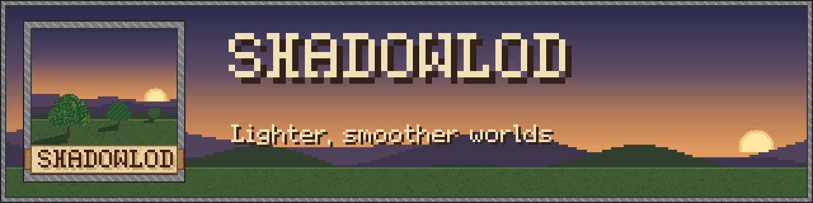

  <b>More FPS, with or without shaders, without changing how your game looks.</b> 
  <i>Crafted by Hardek</i>

  
  
  

  <a href="https://www.curseforge.com/minecraft/mc-mods/shadowlod"><b>CurseForge</b></a> ·
  <a href="../../releases"><b>Download</b></a>

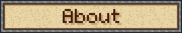

ShadowLOD makes Minecraft lighter and smoother to render, with or without shaders.
Distant mobs turn into flat pictures of their own model, far block entities and particles are skipped,
chunk loading no longer causes stutter, and with shaders on, shadows are only drawn where you can see them.
Your world looks the same, your graphics card just does less work.

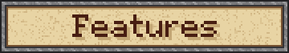

- **Smart shadows** : objects only go into the shadow map when their shadow can land somewhere you can see.
- **Shadow cache** : the terrain shadow is kept and reused until something changes, and updates are spread over several frames to avoid stutter.
- **Distant mob LOD** : beyond 32 blocks, mobs are drawn as flat pictures of their real model, up to 128 blocks.
- **Render distances** : adjustable limits for block entities, particles and translucent sorting.
- **Smooth frames** : chunk loading is spread over frames and slowed down right after a lag spike.
- **Auto tuning** : when the frame rate drops below your target, some distances go down a little on their own.
- **Thread priorities** : the render thread comes first, world generation and Distant Horizons work in the background.
- **Any shader pack** : packs that need a safer setup are detected automatically.

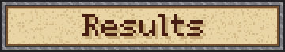

Same spot, same settings, frame rate set to **Unlimited**. Only the mod is turned off (left) or on (right).

| Scene | Off | On | Gain |
|---|:---:|:---:|:---:|
| 🧱 **Wall on a flat world** | 150 FPS | 260 FPS | +73% |
| 🏘️ **Village house** | 44 FPS | 147 FPS | ×3.3 |
| 🏰 **Village with a tower** | 58 FPS | 157 FPS | ×2.7 |
| 🛒 **Market with villagers** | 75 FPS | 90 FPS | +20% |
| 🌙 **Village at night** | 154 FPS | 186 FPS | +21% |
| 🐄 **Pen with 130 cows, far away** | 12 FPS | 236 FPS | ×20 |

*Ryzen 7 9800X3D, Radeon RX 9070 XT, 1440p, Photon shaders, Distant Horizons. Your results depend on the scene and your hardware.*

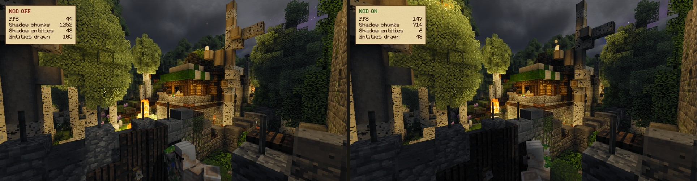

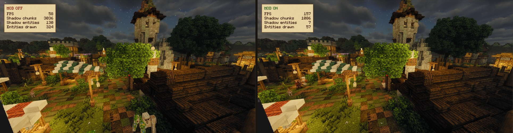

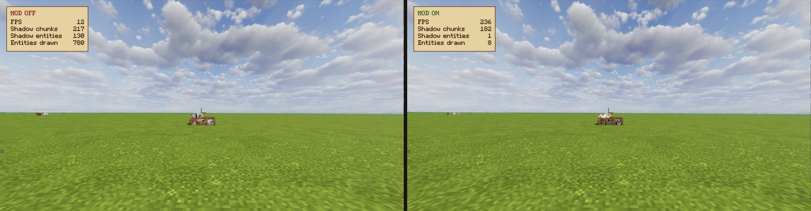

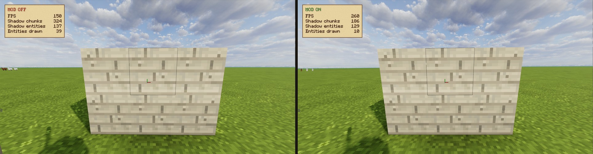

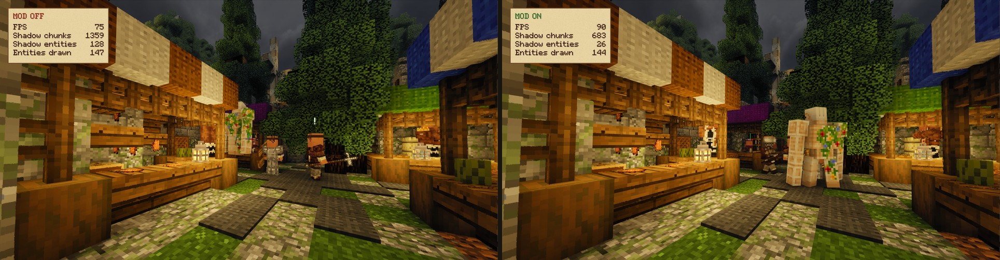

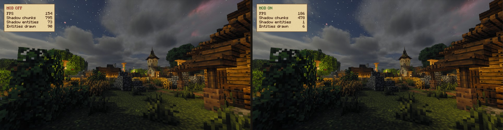

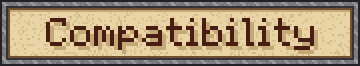

| Mod | Status |
|---|:---:|
| Embeddium | ✅ |
| Oculus (all shader packs) | ✅ |
| Distant Horizons | ✅ |
| Entity Model Features / Fresh Animations | ✅ |
| Entity Culling | ✅ ¹ |
| ImmediatelyFast, ModernFix, FerriteCore | ✅ |
| Faster Iris Shadow Mapper | ✅ ¹ |
| Vanillin / Flywheel | 🟧 ² |
| OptiFine | ❌ |

✅ Works together.

🟧 Works, with a limit.

❌ Not supported.

¹ Recommended alongside ShadowLOD, they cover different parts of rendering.

² Chests, bells and minecarts drawn by Vanillin are not handled by ShadowLOD.

**Requirements:** Minecraft 1.20.1, Forge 47 or newer. Embeddium and Oculus are optional.

**Installation:** drop the `.jar` into your `mods` folder.

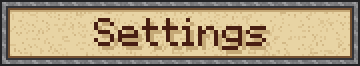

- **Numpad `/`** : turn the mod on or off.
- **Numpad `*`** : turn the shadow optimizations on or off.
- **F3** : live stats for every feature.

All settings are in the mod menu, or in `config/shadowlod-client.toml`.

> **Occlusion** hides terrain behind hills and buildings. It is experimental and off by default, as it can cause slight pop-in when the camera moves fast.

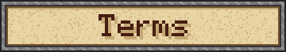

- ✅ Play with it, make videos and screenshots with it.
- ✅ Use it in modpacks, simply link back to the official page please!
- ❌ Don't reupload the mod elsewhere.
- ❌ Don't modify it or publish your own version without my permission.

See [LICENSE.md](LICENSE.md) for details.

© 2026 Hardek. This is NOT an official Minecraft product. Not approved by or associated with Mojang or Microsoft.

